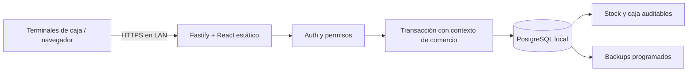

# Arquitectura y decisiones

## Monolito modular

React + TypeScript estricto + Vite en el cliente; Fastify + TypeScript en el servidor; PostgreSQL 18. El bundle estático y la API se sirven desde el mismo proceso en distribución. Los módulos separan autenticación, catálogo/inventario, ventas/pagos, caja, compras/proveedores, clientes/cuentas, reportes y configuración. `lib` concentra sesiones, permisos, transacciones e idempotencia. Contratos Zod y cálculo monetario están en `shared`.

Vite evita añadir un servidor SSR a una aplicación de caja sin necesidades de indexación o contenido público. Fastify aporta un backend estructurado con hooks, límites, logs y manejo centralizado de errores. TanStack Query administra datos de servidor. No se agrega Zustand: el carrito es estado local del POS. Los gráficos se cargan por demanda. Se usan formularios HTML y `dialog` nativo, sin instalar un conjunto completo de bibliotecas de formularios/componentes que este alcance no necesita.

Se eligió **node-postgres y SQL parametrizado**, en lugar de Prisma o Drizzle, para hacer explícitos los bloqueos, RLS, permisos por columna y triggers diferidos de este núcleo. La contrapartida es mantener a mano los tipos de consultas y las migraciones. Zod valida todas las entradas; TypeScript valida el código; la base valida restricciones y referencias. Una futura capa de Drizzle puede añadirse sin sustituir las restricciones de la base. No se construyeron microservicios.

## Aislamiento

`tenant_id` forma parte de cada recurso y de sus claves foráneas a otros recursos comerciales. Una sesión opaca de 256 bits se busca por su hash; la identidad de comercio se obtiene únicamente de esa sesión. Ni body, ni query ni cabeceras permiten seleccionar un tenant autenticado.

Cada operación reserva una conexión del pool, ejecuta `BEGIN`, establece `app.tenant_id` con `set_config(..., true)` y confirma o revierte antes de devolverla. El contexto es local a la transacción; no permanece en la conexión reutilizada. Todas las tablas comerciales tienen `ENABLE` y `FORCE ROW LEVEL SECURITY`. Sin contexto, las lecturas no devuelven filas. Los tests usan el rol real de aplicación y prueban también SQL sin contexto y FK cruzadas.

El rol `modulab_app` no posee tablas, no es superusuario y no tiene BYPASSRLS. El servidor comprueba esto al arrancar. No puede editar el saldo de stock ni modificar/borrar libros financieros. La cuenta administradora/migradora no se entrega al proceso runtime.

Las funciones `auth_lookup`, `session_lookup` y `login_gate` resuelven el arranque de autenticación mediante `SECURITY DEFINER` con `search_path` fijado, tablas calificadas y permisos públicos revocados. Se concede al runtime únicamente ejecución de estas tres funciones. `apply_inventory` es un trigger definidor que modifica sólo la proyección de stock del tenant actual. Su propietario necesita BYPASSRLS (el administrador de instalación utilizado en esta distribución es superusuario). Proteger esa identidad es una condición de despliegue.

RLS protege frente a consultas de aplicación que omitan filtros; no protege frente a un atacante que controle el servidor y sus credenciales y pueda establecer cualquier contexto. Los administradores de la base/host son identidades confiables. No hay cuenta de superadmin SaaS con acceso implícito a los comercios desde la API.

## Dinero y unidades

- ARS se representa en centavos enteros. Precios/costos unitarios: hasta 1.000.000.000 centavos. Total por operación: hasta 1.000.000.000.000 centavos.
- Cantidades en milésimas: `1000` equivale a una unidad o un kg. Los productos por unidad sólo admiten múltiplos de 1000.
- API JSON: enteros seguros. Multiplicaciones, parseo decimal y suma de importes críticos: `bigint` en TypeScript. PostgreSQL utiliza `bigint`/sumas exactas. El parser rechaza valores fuera del rango seguro de JSON.
- Cada renglón redondea medio hacia arriba: `(precio_centavos * cantidad_milésimas + 500) / 1000`, división entera. El total es la suma de los renglones menos el descuento absoluto de venta. Los precios incluyen impuestos; el descuento se distribuye por mayor resto con desempate estable y luego se extrae el impuesto por línea con BigInt. La base verifica descuento, impuesto y vuelto al commit. No se aceptan totales o precios declarados por el navegador: se recalculan con precios bloqueados de base.
- El precio mostrado puede cambiar entre agregar y cobrar. Antes de abrir cobro se refresca el producto. Si cambia nuevamente, el servidor rechaza pagos que no cubran el total actual; no confirma un precio viejo silenciosamente.
- Los números decimales usados por `Intl`, gráficos y exportación son presentación; no se usan para asentar pagos o stock.
- Costo y nombre se guardan en cada línea de venta. Cambiar el costo actual no reescribe rentabilidad histórica. El resultado es estimado y no sustituye liquidación impositiva o contable.

## Confirmar una venta

1. Validar estructura, permiso de venta, descuento y datos de pago.
2. Tomar un bloqueo asesor por comercio + clave UUID de venta. Si ya existe: comparar hash de contenido y usuario, devolver la misma operación o rechazar un uso incompatible.
3. Bloquear el turno, verificar empleado y estado abierto. Bloquear productos en orden de UUID y validar actividad/unidades.
4. Calcular importes exactos. Validar pagos únicos, vuelto sólo de efectivo y cuenta corriente asociada a cliente. Bloquear al cliente y comprobar límite bajo ese bloqueo.
5. Incrementar la numeración transaccional del comercio, guardar la venta y snapshots, líneas y pagos; insertar movimientos de stock, efectivo y cuenta; insertar auditoría.
6. Al commit, triggers diferidos verifican líneas, pagos y sus movimientos relacionados. Cualquier error revierte también la numeración, el stock y la caja.

La proyección `products.stock_milli` sólo se actualiza por trigger después de insertar un movimiento. Un trigger impide fracciones para artículos por unidad. La política de negativos se aplica en la base. Para deshabilitarla hay que regularizar primero las existencias negativas.

Los bloqueos de turno serializan caja/venta/cierre de un mismo empleado. Distintas cajas comparten bloqueos de productos: sólo una puede adquirir la última unidad si no se permiten negativos. Las excepciones de bloqueo/concurrencia devuelven un error recuperable; no hay reintento automático con una clave distinta.

## Reintentos y recuperación del navegador

El POS guarda el carrito y, **antes** de enviar una venta, su intención completa y UUID en almacenamiento local con clave por comercio/usuario. Mientras el resultado es ambiguo no permite editar esa intención. Un reintento, incluso tras recargar, envía exactamente el mismo contenido. La base responde con la operación confirmada si ya existía. Playwright comprueba el caso en que el servidor confirma y se descarta la respuesta.

Estos datos son borradores operativos, no secretos de autenticación ni una base contable. Los historiales confirmados están en PostgreSQL. Borrar el almacenamiento del navegador durante una operación ambigua destruye la clave local de recuperación: primero se debe verificar el historial en el servidor. No se promete recuperación si se pierde a la vez todo el disco local y el servidor sin backup.

Recepciones y devoluciones totales son idempotentes por compra/venta. Ajustes, ingresos/retiros y cobranzas usan claves únicas; aumentos masivos almacenan comando, hash y resultado para no aplicar dos veces un porcentaje. Alta de productos y compras se protegen además con SKU/código y referencia de proveedor únicos.

## Libros y correcciones

Ventas, líneas, pagos, devoluciones, movimientos de inventario/cliente/caja, pagos a proveedores, comandos y auditoría no permiten UPDATE ni DELETE. Se conserva el original y se agregan movimientos compensatorios. La devolución total guarda su propio evento, repone stock y compensa efectivo/cuenta. Los reintegros de medios electrónicos se ejecutan externamente: la aplicación no devuelve fondos bancarios.

Caja permite una transición de abierto a cerrado. Su apertura y su cierre no se editan. Compras permite sólo pedido → recepción completa, y valida que la recepción coincida con movimientos de inventario. El stock no aumenta al registrar el pedido.

## Definición de reportes

Período inclusivo por fecha local del comercio, máximo 367 días. Ventas se reconocen al confirmar y devoluciones en la fecha efectiva de devolución, incluso si la venta es anterior al período.

- Ventas brutas: suma de subtotales de ventas confirmadas del período, antes de descuentos.
- Ventas netas: total de ventas después de descuentos, menos totales devueltos durante el período.
- Operaciones: cantidad de ventas confirmadas; devoluciones se cuentan por separado.
- Ticket promedio: total original cobrado/puesto a cuenta en ventas del período dividido por operaciones; no se reduce por devoluciones de ventas de otros días.
- Costo neto: costo guardado en las líneas vendidas menos costo de las líneas devueltas en el período.
- Resultado estimado: ventas netas (con impuestos incluidos) menos costo cargado neto de devoluciones. No separa impuestos de compra ni incluye gastos/amortizaciones; no es resultado fiscal.
- Medios de pago: importes aplicados de ventas menos devoluciones. Los pendientes se informan por separado, excluyendo los que ya tienen una confirmación manual inmutable. Los reportes usan una transacción REPEATABLE READ READ ONLY para mantener una instantánea entre totales y detalles. Cuenta corriente es deuda, no ingreso bancario.
- Caja: fondo inicial + movimientos de efectivo. Transferencias y tarjetas no alteran el efectivo físico.
- Stock valorizado: existencias actuales × costo actual. Productos por reponer: stock menor o igual al mínimo.
- Ranking: cantidades de renglones vendidas menos devueltas; sus importes brutos no distribuyen el descuento global por producto.

## Referencias de diseño

[PostgreSQL: políticas RLS](https://www.postgresql.org/docs/current/ddl-rowsecurity.html), [Fastify: validación y serialización](https://fastify.dev/docs/latest/Reference/Validation-and-Serialization/), [OWASP: prevención de CSRF](https://cheatsheetseries.owasp.org/cheatsheets/Cross-Site_Request_Forgery_Prevention_Cheat_Sheet.html). Son referencias, no certificaciones del producto.

## Sesión, navegador y adaptadores

`session_lookup` exige usuario activo, vencimiento absoluto y `last_active_at` dentro del plazo del comercio. El navegador registra interacción real y envía actividad de forma limitada; polling de salud/reportes no renueva sesión. El bloqueo limpia datos de sesión de memoria y vuelve al login, conservando borradores por comercio/usuario. La interfaz tiene un ErrorBoundary y errores de transporte recuperables.

Las consultas locales usan `networkMode: always`: `navigator.onLine=false` no debe impedir acceder al servidor de la LAN cuando se pierde internet. Se prueba ese escenario y se bloquean servicios externos en el smoke de navegador. Sin servidor no se contabiliza una venta. Web Locks y eventos de storage coordinan pestañas de un mismo perfil; la prueba simultánea confirma una sola venta para un carrito compartido.

`PaymentRecorder` registra una declaración del operador y nunca cobra. `FiscalProvider` emite sólo metadatos de ticket comercial sin código de autorización. PDFKit genera PDF en el servidor. La impresión física usa el navegador con driver de sistema y conserva descarga PDF si la impresora no está disponible.
